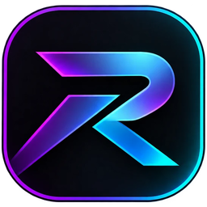
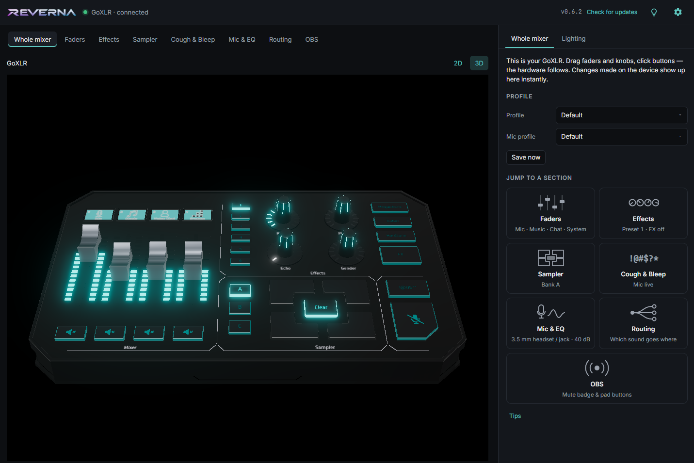
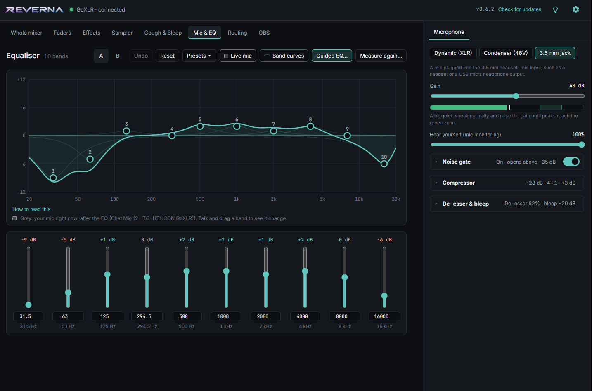
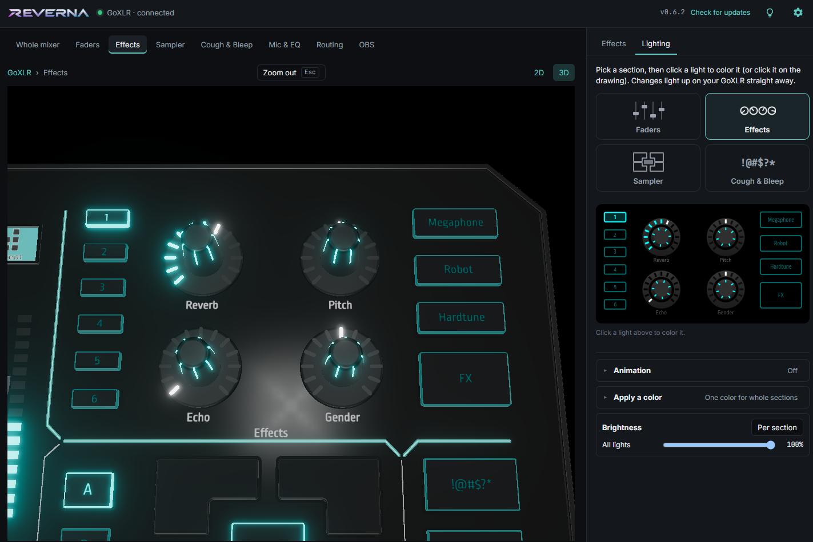
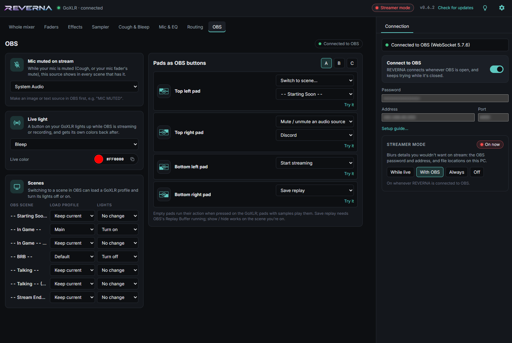
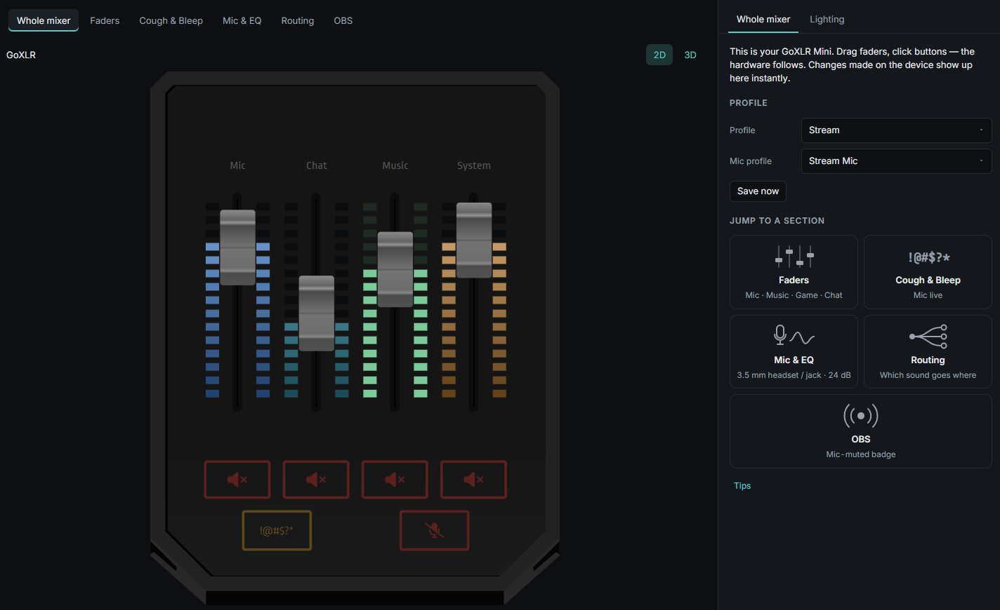

  

<h1 align="center">
  
</h1>

<b>A modern control app for the TC-Helicon GoXLR and GoXLR Mini, on Windows.</b>

REVERNA shows your GoXLR as an interactive drawing (or a 3D model) that mirrors the real thing:
move a fader, press a button or change a light on either one and the other follows. Everything
the GoXLR can do is one click away, plus a few things it couldn't do before.

**[⬇ Download the latest version](../../releases/latest)** — pick the file ending in `-setup.exe`.

> REVERNA is an independent community project. It is not affiliated with, endorsed by or
> supported by TC-Helicon, Music Tribe or the GoXLR Utility project. "GoXLR" is a trademark of
> its owner, used here only to say which hardware REVERNA works with.

## A look inside

  
   Your GoXLR in 3D: every fader, knob, button and light, live.

<table>
  <tr>
    <td width="50%" align="center" valign="top">
      
       Mic &amp; EQ: drag the bands and watch your mic live.
    </td>
    <td width="50%" align="center" valign="top">
      
       Lighting: pick any light on the map and color it.
    </td>
  </tr>
  <tr>
    <td width="50%" align="center" valign="top">
      
       OBS integration: pads as OBS buttons, a live light, and scenes that load your GoXLR setup.
    </td>
    <td width="50%" align="center" valign="top">
      
       Works with the GoXLR Mini too.
    </td>
  </tr>
</table>

## What it does

- **Your GoXLR, on screen.** A live 2D drawing or 3D model of your full-size GoXLR or Mini. Faders,
  knobs, mutes, the sampler and every light update as you use the hardware, and you can control
  them from the screen too.
- **OBS integration.** Pad actions (scenes, streaming, recording, mutes, filters), a live light
  on the GoXLR while you're streaming, and scenes that can load a GoXLR profile.
- **Mixer & routing.** Fader channels, mute behaviour, Cough and Bleep, and a routing grid for
  where each input goes.
- **Lighting.** Every light, color and animation, with small maps of each section to pick from,
  and a Lights off switch that brings your colors back exactly as they were.
- **Mic & EQ.** A 10-band EQ (6 bands on the Mini) you can drag on a graph, with a live view of your mic. **Guided EQ**
  listens to you read a short text and suggests EQ, noise gate, gain and compressor settings,
  each with the reason, and lets you hear before and after before you apply anything.
- **Sampler.** A sample library, drag-and-drop import, recording from the pads, and an editor to
  trim, cut out parts and set the volume of each sample.
- **Bring your setup.** On first run REVERNA can import your profiles, mic profiles and samples
  from the official GoXLR app. Your original files are only ever copied, never changed.

### On the GoXLR Mini

REVERNA supports everything the Mini has. The Mini itself has less hardware than the full-size
GoXLR, so some parts of REVERNA don't appear for it:

- **No effects or sampler.** The Mini has no effect knobs or buttons and no sample pads, so the
  Effects and Sampler sections (and using pads as OBS buttons) are full-size only.
- **No scribble strips.** The Mini's fader labels are printed on it.
- **Faders aren't motorised.** REVERNA shows where the Mini's faders are, but can't move them:
  move them on the Mini. A fader's volume can still be set from REVERNA's side panel, until the
  fader is moved again.
- **A 6-band EQ** instead of 10.

Mixer and routing, mutes, Cough and Bleep, lighting, Mic & EQ (Guided EQ included), and the OBS
mic-muted badge, live light and scenes all work on the Mini.

## Requirements

- **Windows 11** (Windows 10 works on a best-effort basis), 64-bit.
- A **GoXLR** or **GoXLR Mini**, connected by USB.
- The **TC-Helicon GoXLR driver**. If it's missing, REVERNA offers to download and install it.

## Installing

1. Download the latest `REVERNA_x.y.z_x64-setup.exe` from **[Releases](../../releases/latest)**.
2. **Close the official GoXLR app** if it's running: only one app can control the GoXLR at a time.
3. Run the installer. It installs for your Windows user only, with no administrator rights needed.
4. Windows may say *"Windows protected your PC"*. REVERNA isn't code-signed yet, so Windows
   doesn't recognise the publisher. Click **More info**, then **Run anyway**.
5. REVERNA opens and starts its GoXLR service. On the first run it offers to import your setup
   from the official GoXLR app.

REVERNA includes everything it needs, including the GoXLR service that talks to the hardware.
There's nothing else to install.

## Updates

REVERNA checks for a new version shortly after it starts (and whenever you click **Check for
updates**). If there is one, it shows a banner. **It never updates on its own**: click
**Install and restart** when it suits you.

Every update is signed. REVERNA verifies the signature before installing and refuses anything
that wasn't signed with the project's private key, so a download can't be swapped for something
else.

## Your data

- REVERNA runs on your PC. It doesn't collect or send any usage data.
- It goes online only to check this page for updates, and to download the GoXLR driver if you
  ask it to.
- Your profiles, mic profiles and samples are kept in the GoXLR service's folders on your PC.

## Uninstalling

Windows **Settings → Apps → Installed apps → REVERNA → Uninstall**. Your profiles and samples
are left in place.

## Credits

REVERNA is built on the open-source **[GoXLR Utility](https://github.com/GoXLR-on-Linux/goxlr-utility)**
(MIT License, © Craig McLure and Nathan Adams), bundled unmodified. Its device drawings are adapted
from **[GoXLR UI](https://github.com/GoXLR-on-Linux/goxlr-ui)** (MIT License). Thank you to
everyone who works on those projects.

REVERNA itself is released under the MIT License.
